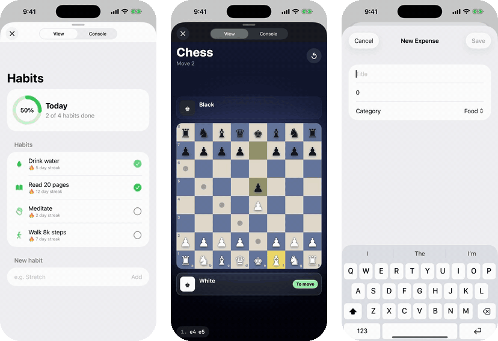
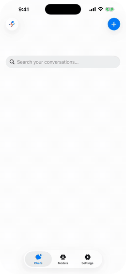
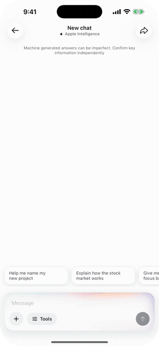
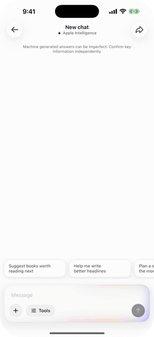

<p align="center">
  
</p>

<h1 align="center">Kiln</h1>

<p align="center">
  Run SwiftUI from a string, on device. Real views, real state, no compiler.<br />
  It is the Run button on Swift code in <a href="https://haploapp.com">Haplo AI</a>: ask for an app, tap Run, use it.
</p>

<p align="center">
  
  
  
  
  
</p>

<p align="center">
  <a href="https://buymeacoffee.com/jcbuilds"></a>
  <br>
  <sub>If Kiln is useful to you, a coffee keeps it going.</sub>
</p>

---

```swift
let result = Kiln.run(source)   // result.view is a live SwiftUI view
```

Kiln parses Swift source at runtime and interprets it: structs, classes, enums, closures and the rest of the language, with every `View` you write hosted by a real SwiftUI view that owns its own `@State`. Lists, forms, pickers, sheets, navigation, timers and charts are the real SwiftUI controls, so an app a model writes in a chat reply runs on the phone a moment later and behaves the way it would if you compiled it.

**[Download the demo video (MP4)](assets/demo.mp4)**

## What it looks like

| A habit tracker | An expense tracker | A memory game |
|:---:|:---:|:---:|
|  |  |  |
| A `List` with sections and a progress ring that fills as habits are checked off. | Swift Charts, a sheet with a form, and a section per category. | A grid of flipping cards, a move counter and a win message. |

<sub>Staged demos, recorded in the iOS Simulator inside <a href="https://haploapp.com">Haplo AI</a>. The model's replies are scripted so every take has the same code (each is one of the apps in <a href="Examples/Apps">Examples/Apps</a>); tapping Run, the sheet and the app Kiln runs from that code are real, and the taps come from a UI test.</sub>

## Installation

In Xcode: **File > Add Package Dependencies** and paste

```
https://github.com/haplollc/Kiln
```

Or in `Package.swift`:

```swift
dependencies: [
    .package(url: "https://github.com/haplollc/Kiln", from: "0.2.0")
]
```

Then add `Kiln` to your target's dependencies.

## Quick start

`KilnView` runs whatever source you give it and re-runs when it changes.

```swift
import SwiftUI
import Kiln

struct Playground: View {
    @State private var source = """
    struct ContentView: View {
        @State private var count = 0
        var body: some View {
            Button("Tapped \\(count) times") { count += 1 }
        }
    }
    """

    var body: some View {
        VStack {
            TextEditor(text: $source).font(.body.monospaced())
            KilnView(code: source)
        }
    }
}
```

Kiln shows `ContentView` if there is one; otherwise an `@main App`, a `#Preview`, a `PreviewProvider`, or the view no other view uses.

## Running code from a chat reply

Models often split one app across several code blocks (the model type in one, the view in the next). Kiln has helpers for exactly that:

```swift
// Everything in the reply, in order; a later block that redeclares a type replaces it.
let source = Kiln.swiftSource(fromMarkdown: reply)

// The block a person tapped Run on, plus only the blocks it needs from the same reply.
let source = Kiln.swiftSource(running: tappedBlock, inReply: reply)

// A whole app screen (navigation, List, Form, TabView …) wants the full height.
let fullHeight = Kiln.looksLikeApp(source)

// Check code before showing it: evaluates every view and fires every action once, headless.
let check = Kiln.validate(source)   // check.isValid, check.errors
```

## What Kiln runs

**Swift.** Structs as values (copies, `mutating`, memberwise and custom `init`s, `didSet`), classes as references (`ObservableObject` with `@Published`, `@Observable`), enums with raw values, payloads, `CaseIterable` and methods, closures that capture by reference, `switch` with patterns, ranges, tuples and `where`, `if let` / `guard let` / `while let`, optionals with `?.` and `??`, `defer`, `do` / `catch` / `throw`, extensions on your types and on built-in ones, and `Int` and `Double` kept apart. Runaway loops and runaway recursion are stopped and reported; they never hang the app.

**SwiftUI.** Every `View` struct you write is hosted by a real SwiftUI view, so `@State` lives and dies by SwiftUI's own identity rules, and `@Binding`, `@StateObject`, `@ObservedObject`, `@EnvironmentObject`, `@Environment(\.dismiss)` and `@AppStorage` behave as compiled. `List` (rows, sections, `onDelete`), `Form`, `Section` headers and footers, `Picker` with tags (segmented, menu, wheel), `Stepper`, `Toggle`, `Slider`, `TextField` with text or `value:format:`, `DatePicker`, `NavigationStack` with `navigationDestination`, `TabView`, `.searchable`, sheets, alerts, toolbars, `Timer.publish` with `onReceive`, `withAnimation` and transitions, Swift Charts, custom `Shape`s and `Path`, grids, `GeometryReader`, and about 120 modifiers. Text is formatted the way SwiftUI formats it (`Text("\(1400) pages")` reads "1,400 pages").

**Networking.** `try await URLSession.shared.data(from:)` (or `for:` a `URLRequest`), `dataTask(with:) { … }.resume()`, `URLComponents` and `URLQueryItem`, and `JSONDecoder().decode(T.self, from:)` into your own `Decodable` types, with `CodingKeys`, `.convertFromSnakeCase`, optionals, defaults, nested types and raw-value enums.

**Repeatable runs.** Set `Kiln.randomSeed` and `shuffled()`, `randomElement()` and `random(in:)` give the same numbers every run; `KilnRandom(seed:)` gives native Swift the same ones. A host app launched with `-KilnRandomSeed 7` starts seeded, which is handy in UI tests (the memory game above is dealt that way).

## Checked against native SwiftUI

`Lab/` is Kiln Lab, an iOS app that shows each example in [Examples/Apps](Examples/Apps) either compiled natively or run by Kiln. One UI test drives both the same way (tap, type, wait for a timer, swipe to delete) and saves every screen. `Tools/iterate.sh` runs a headless check of every example and of Apple Intelligence's own replies in [Examples/AppleIntelligence](Examples/AppleIntelligence), then the UI tests, and writes a report with native, Kiln, and the blocks that differ side by side.

| Pass | Apps matching native on every step | Labels matching | Apple Intelligence replies that run |
|---|---|---|---|
| The original interpreter | 0 of 5 | 0% | 1 of 4 |
| Kiln engine 2, first run | 1 of 5 | 79% | 5 of 5 |
| Computed properties read live `@State`; a title bug | 4 of 5 | 98% | 5 of 5 |
| Seeded runs; `Color` opacity as a style | 5 of 5 | 100% | 5 of 5 |
| A sixth app (tabs, search, a shared store); SwiftUI's number formatting | 6 of 6 | 100% | 5 of 5 |

## Two engines

`Kiln.run` and `Kiln.validate` use the engine described above. Code written for the original interpreter's guided dialect (`GameCanvas`, `.onTick`, `.onSwipe`, `.dragToMove`, `Storage`, `BarChart(` / `LineChart(`, `Map(latitude:`) still runs on the original interpreter. Set `Kiln.engine = .legacy` to use it for everything.

## API

```swift
public enum Kiln {
    @MainActor static func run(_ code: String) -> KilnResult
    @MainActor static func validate(_ code: String, ticks: Int = 8, fuel: Int = 2_000_000) -> KilnValidation
    static func swiftSource(fromMarkdown markdown: String) -> String
    static func swiftSource(running block: String, inReply markdown: String) -> String
    static func looksLikeApp(_ code: String) -> Bool
    @MainActor static var engine: Engine            // .automatic, .modern, .legacy
    @MainActor static var randomSeed: UInt64?
    @MainActor static var hostImageProvider: ((String) -> Image?)?
}

public struct KilnResult { let view: AnyView?; let consoleOutput: String; let errors: [String] }
public struct KilnValidation { let errors: [String]; let warnings: [String]; var isValid: Bool }
public struct KilnView<ErrorContent: View>: View { init(code: String) }
public struct KilnRandom: RandomNumberGenerator { init(seed: UInt64?) }
```

## Limitations

Kiln interprets; it does not compile, so some things are out of reach:

- No UIKit or AppKit bridges (`UIViewRepresentable`), no SwiftData or Core Data, no third-party packages.
- `async` code runs straight through: `Task.sleep` does not wait, and `await URLSession.shared.data(from:)` waits for the response (up to 20 seconds) before the next line runs. `dataTask(with:)` with a completion handler does not wait.
- Protocols are accepted but conformance is not checked; user-defined property wrappers and result builders are not supported.

When something is out of reach Kiln reports the line it stopped on instead of crashing.

## License

MIT. See [LICENSE](LICENSE).

## Credits

Built by [@jc_builds](https://twitter.com/jc_builds) at [Haplo](https://haploapp.com), where it runs the code in Haplo AI's chat replies.
